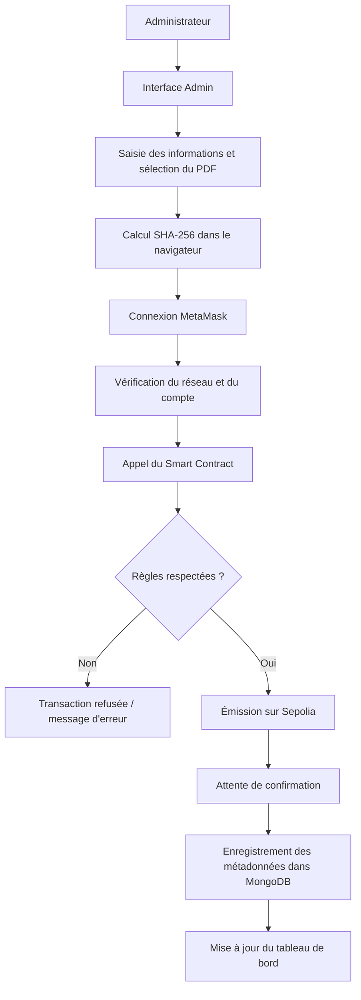
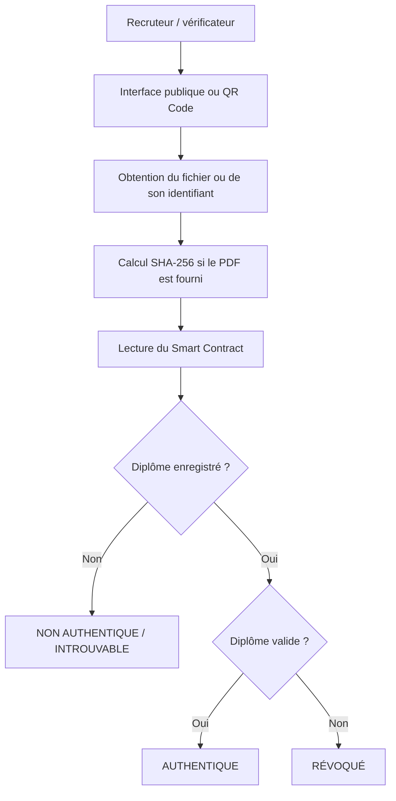
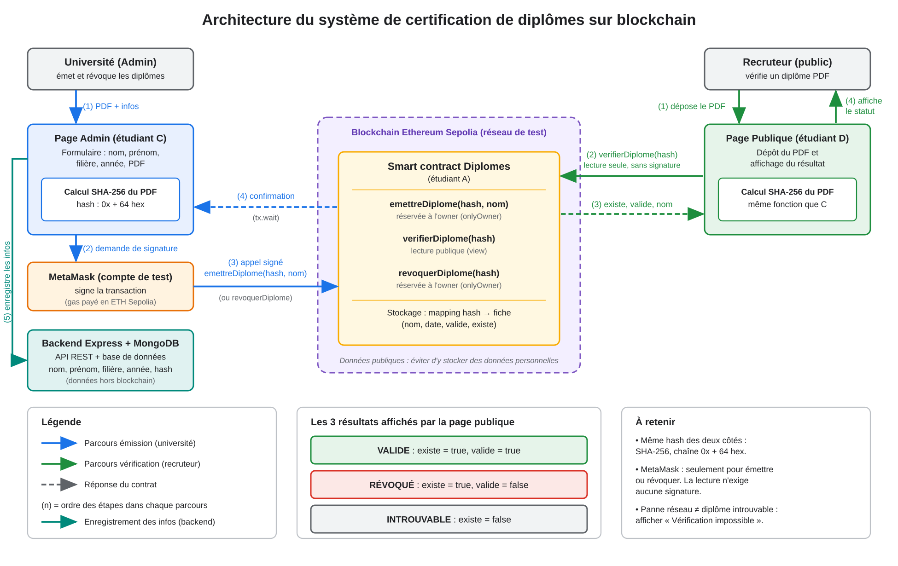
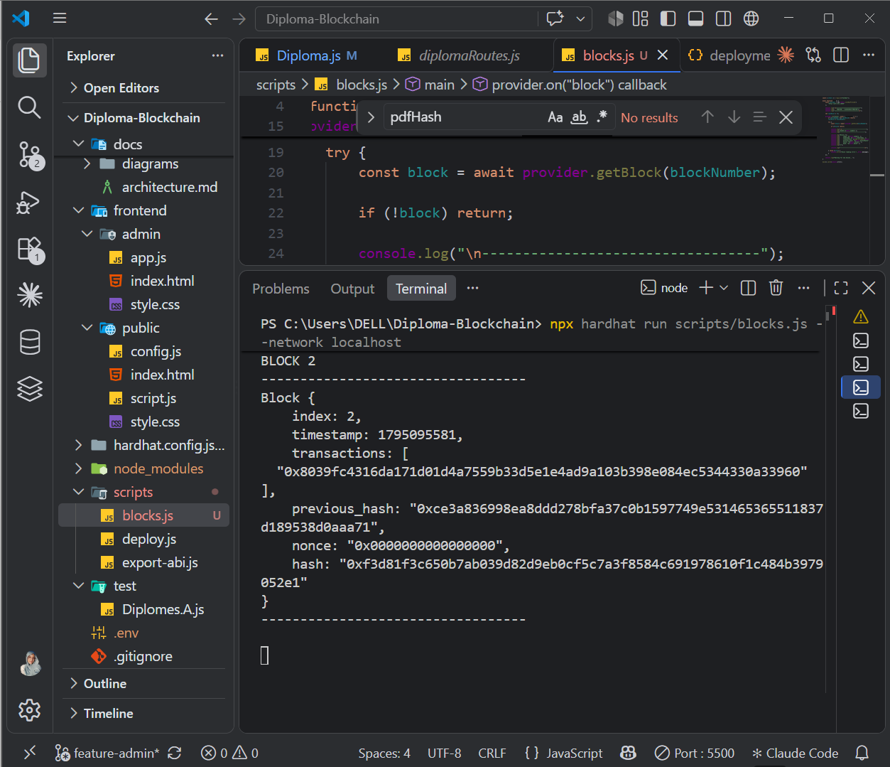
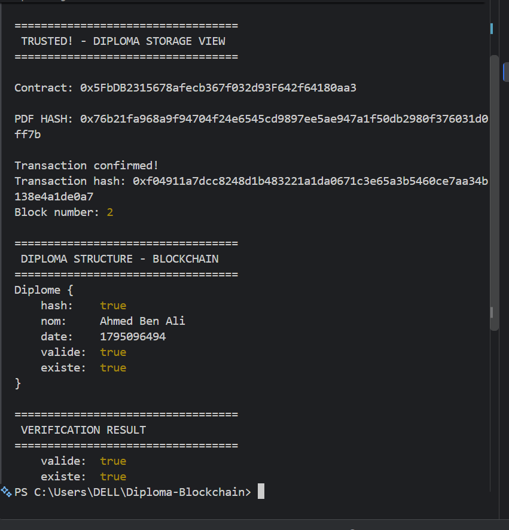

# DiplomaChain --- Certification et vérification de diplômes sur blockchain

> Application de certification de diplômes universitaires basée sur
> Ethereum. L'université émet un diplôme depuis une interface
> d'administration ; son empreinte cryptographique est enregistrée sur
> la blockchain. Un utilisateur externe peut ensuite vérifier son
> authenticité à travers l'interface publique.

------------------------------------------------------------------------

## Table des matières

-   [1. Présentation du projet](#1-présentation-du-projet)
-   [2. Objectifs](#2-objectifs)
-   [3. Fonctionnement général](#3-fonctionnement-général)
-   [4. Architecture](#4-architecture)
-   [5. Technologies utilisées](#5-technologies-utilisées)
-   [6. Structure du dépôt](#6-structure-du-dépôt)
-   [7. Prérequis](#7-prérequis)
-   [8. Installation et configuration](#8-installation-et-configuration)
-   [9. Compilation, tests et
    déploiement](#9-compilation-tests-et-déploiement)
-   [10. Utilisation de l'application](#10-utilisation-de-lapplication)
-   [11. Smart Contract : logique et
    sécurité](#11-smart-contract--logique-et-sécurité)
-   [12. Tests unitaires](#12-tests-unitaires)
-   [13. Gestion des données : blockchain et
    MongoDB](#13-gestion-des-données--blockchain-et-mongodb)
-   [14. Intégration MetaMask et gestion des
    transactions](#14-intégration-metamask-et-gestion-des-transactions)
-   [15. Répartition des rôles et intégration
    d'équipe](#15-répartition-des-rôles-et-intégration-déquipe)
-   [16. Démonstration proposée pour la
    soutenance](#16-démonstration-proposée-pour-la-soutenance)
-   [17. Dépannage](#17-dépannage)
-   [18. Sécurité et bonnes pratiques](#18-sécurité-et-bonnes-pratiques)
-   [19. Limites et améliorations
    possibles](#19-limites-et-améliorations-possibles)
-   [20. Livrables](#20-livrables)

------------------------------------------------------------------------

## 1. Présentation du projet

La falsification de diplômes peut nuire aux établissements
universitaires, aux recruteurs et aux diplômés. La vérification manuelle
de documents papier ou PDF peut être longue et ne garantit pas toujours
que le document présenté est original.

**DiplomaChain** propose une solution de certification fondée sur la
blockchain. Lorsqu'un diplôme est émis, l'application calcule son
empreinte numérique avec **SHA-256**. Cette empreinte est ensuite
enregistrée dans un **Smart Contract Solidity** déployé sur le réseau de
test **Sepolia**.

La blockchain fournit un registre partagé, traçable et difficile à
modifier rétroactivement. La vérification repose sur la comparaison de
l'empreinte du document avec l'enregistrement du Smart Contract.

### Problématique

Comment permettre à un établissement universitaire d'émettre des
diplômes numériques et à un tiers de vérifier leur authenticité de
manière fiable, sans devoir faire confiance uniquement à une base de
données centralisée ?

### Solution proposée

1.  L'administrateur saisit les informations du diplômé et sélectionne
    le PDF.
2.  Le navigateur calcule le hash SHA-256 du fichier.
3.  MetaMask autorise le compte universitaire à envoyer une transaction.
4.  Le Smart Contract vérifie les règles métier et enregistre le
    diplôme.
5.  Les informations de gestion sont sauvegardées dans MongoDB via l'API
    backend.
6.  L'interface publique permet de vérifier le diplôme à partir de son
    empreinte ou du mécanisme d'identification prévu par l'application.

------------------------------------------------------------------------

## 2. Objectifs

-   Garantir qu'un fichier PDF n'a pas été modifié depuis sa
    certification.
-   Empêcher l'émission répétée du même hash.
-   Réserver les opérations sensibles au propriétaire autorisé du
    contrat.
-   Permettre la consultation de l'état d'un diplôme.
-   Permettre la révocation d'un diplôme sans effacer son historique.
-   Séparer la preuve d'authenticité, conservée sur la blockchain, des
    données utiles à la gestion administrative.
-   Fournir une interface simple pour l'administrateur et une interface
    de vérification pour le public.

------------------------------------------------------------------------

## 3. Fonctionnement général

### 3.1 Parcours d'émission



### 3.2 Parcours de vérification



> **Important :** un QR Code qui contient uniquement un identifiant
> permet de retrouver un enregistrement, mais ne prouve pas à lui seul
> que le PDF présenté est l'original. Pour vérifier le fichier lui-même,
> il faut calculer son SHA-256 et le comparer au hash enregistré sur la
> blockchain.

------------------------------------------------------------------------

## 4. Architecture

Le projet est organisé en plusieurs composants complémentaires. Le schéma ci-dessous présente les échanges entre les interfaces, le calcul du hash, le Smart Contract, le backend et MongoDB.



*Figure — Architecture globale de Trusted! : le hash SHA-256 du PDF est enregistré dans le Smart Contract ; MongoDB conserve uniquement les métadonnées administratives et le hash de transaction.*

  -----------------------------------------------------------------------
  Composant                           Responsabilité
  ----------------------------------- -----------------------------------
  Interface Admin                     Saisie des informations, sélection
                                      du PDF et lancement de l'émission

  SHA-256                             Calcul de l'empreinte numérique du
                                      PDF

  MetaMask                            Gestion du portefeuille et
                                      signature des transactions

  Ethers.js                           Communication entre JavaScript et
                                      le Smart Contract

  Smart Contract Solidity             Contrôle des autorisations,
                                      émission, consultation et
                                      révocation

  Réseau Sepolia                      Réseau Ethereum de test qui héberge
                                      le contrat

  Backend Express                     API HTTP pour enregistrer et
                                      consulter les métadonnées

  MongoDB                             Stockage des informations
                                      administratives et affichage du
                                      tableau de bord

  Interface publique                  Vérification du diplôme par lecture
                                      du contrat
  -----------------------------------------------------------------------

### 4.1 Séparation des responsabilités

-   **Blockchain :** preuve technique d'enregistrement, hash, date et
    statut du diplôme.
-   **MongoDB :** données administratives nécessaires à la gestion, à la
    recherche et au tableau de bord.
-   **Frontend :** expérience utilisateur et orchestration des
    opérations.
-   **Backend :** réception, validation et persistance des métadonnées.

MongoDB ne remplace pas la preuve blockchain. Une donnée présente dans
MongoDB ne suffit pas à déclarer un diplôme authentique : la
vérification doit se référer au Smart Contract.

### 4.2 Pourquoi SHA-256 ?

SHA-256 est une fonction de hachage cryptographique. Elle transforme le
contenu du PDF en une empreinte de longueur fixe de 256 bits,
généralement représentée par 64 caractères hexadécimaux.

-   Le même fichier produit le même hash.
-   Une modification du fichier produit normalement une empreinte
    différente.
-   Le hash permet de comparer un fichier sans enregistrer le PDF
    complet sur la blockchain.

Le hash est une empreinte, pas un mécanisme de chiffrement : il ne
permet pas de retrouver le contenu original du PDF.

------------------------------------------------------------------------

## 5. Technologies utilisées

- **Solidity** — développement du Smart Contract qui gère l'émission, la vérification et la révocation des diplômes.
- **Hardhat** — compilation du contrat, environnement blockchain local et exécution des tests.
- **Chai** — assertions utilisées dans les tests automatisés.
- **Ethereum Sepolia** — réseau de test utilisé pour le déploiement du Smart Contract.
- **MetaMask** — connexion du portefeuille et signature des transactions par l'administrateur.
- **Ethers.js v6** — interaction JavaScript avec le réseau Ethereum et le Smart Contract.
- **HTML / CSS / JavaScript** — développement des interfaces web Admin et publique.
- **Web Crypto API** — calcul du hash SHA-256 du fichier PDF directement dans le navigateur.
- **Node.js** — environnement d'exécution JavaScript du backend.
- **Express.js** — création de l'API REST.
- **MongoDB** — base de données documentaire pour les métadonnées administratives.
- **Mongoose** — modélisation des données et accès à MongoDB.
- **Git / GitHub** — gestion des versions et collaboration entre les membres de l'équipe.

------------------------------------------------------------------------

## 6. Structure du dépôt

La structure fonctionnelle du dépôt est organisée autour du contrat, des
tests, du frontend et du backend. Les noms exacts de certains fichiers
peuvent varier selon la dernière version intégrée par l'équipe.

``` text
Diploma-Blockchain/
│
├── contracts/
│   ├── Diplomes.sol
│   └── deployment.json
│
├── test/
│   └── Diplomes.js
│
├── scripts/
│   ├── deploy.js
│   ├── blocks.js
│   └── visualize_diploma.js
│
├── doc/
│   └── diagrams/
│       └── architecture.png
│
├── docs/
│   └── images/
│       ├── visualisation-bloc-hardhat.png
│       └── visualisation-diplome-smart-contract.png
│
├── frontend/
│   ├── admin/
│   │   ├── index.html
│   │   ├── style.css
│   │   └── app.js
│   │
│   └── public/
│       ├── index.html
│       ├── style.css
│       └── [scripts de vérification]
│
├── backend/
│   ├── server.js
│   ├── config/
│   │   └── database.js
│   ├── models/
│   │   └── Diploma.js
│   └── routes/
│       └── diplomaRoutes.js
│
├── .env                 # local uniquement, non versionné
├── .gitignore
├── package.json
├── package-lock.json
└── README.md
```

### Fichiers importants

-   `contracts/Diplomes.sol` : règles métier et fonctions blockchain.
-   `contracts/deployment.json` : adresse du contrat et ABI utilisés par
    le frontend.
-   `scripts/deploy.js` : script de déploiement.
-   `test/Diplomes.js` : tests du contrat.
-   `frontend/admin/app.js` : connexion MetaMask, calcul du hash,
    émission et tableau de bord.
-   `scripts/blocks.js` : surveillance des nouveaux blocs du nœud
    Hardhat local.
-   `scripts/visualize_diploma.js` : démonstration locale de l'émission
    et de la lecture des informations d'un diplôme dans le contrat.
-   `doc/diagrams/architecture.png` : schéma visuel de l'architecture globale du projet.
-   `docs/images/` : captures de la visualisation des blocs et des
    données du diplôme dans le terminal.
-   `backend/server.js` : démarrage du serveur Express.
-   `backend/models/Diploma.js` : modèle MongoDB.
-   `backend/routes/diplomaRoutes.js` : routes de l'API.

------------------------------------------------------------------------

## 7. Prérequis

Installer les outils suivants :

1.  **Node.js et npm** --- environnement JavaScript et gestion des
    dépendances.
2.  **Git** --- gestion du code source.
3.  **Visual Studio Code** --- éditeur recommandé.
4.  **MetaMask** --- portefeuille de test dans le navigateur.
5.  **MongoDB** --- serveur local ou instance MongoDB accessible.
6.  **ETH Sepolia** --- fonds de test nécessaires au paiement du gas
    lors du déploiement et des transactions.

Vérifier Node.js et npm :

``` powershell
node -v
npm -v
git --version
```

Les ETH de Sepolia sont des jetons de test et n'ont pas de valeur
monétaire réelle. Utiliser uniquement un portefeuille de test pour le
projet.

------------------------------------------------------------------------

## 8. Installation et configuration

### 8.1 Cloner le dépôt

``` powershell
git clone https://github.com/tesnim44/Diploma-Blockchain.git
cd Diploma-Blockchain
```

### 8.2 Installer les dépendances

À la racine du projet :

``` powershell
npm install
```

Ne pas versionner `node_modules`. Le dossier est recréé par
`npm install` à partir du fichier de dépendances.

### 8.3 Configurer les variables d'environnement

Créer un fichier `.env` à la racine du projet, selon les variables
réellement lues par les scripts et le backend :

``` env
SEPOLIA_RPC_URL=YOUR_SEPOLIA_RPC_URL
PRIVATE_KEY=YOUR_TEST_WALLET_PRIVATE_KEY

MONGODB_URI=mongodb://127.0.0.1:27017/DiplomaDB
PORT=3000
```

**Remplacer les valeurs d'exemple par les valeurs locales adaptées.**
Vérifier les noms exacts attendus dans le code de configuration du
projet avant de lancer les scripts.

-   `SEPOLIA_RPC_URL` : URL du fournisseur RPC Sepolia.
-   `PRIVATE_KEY` : clé privée d'un portefeuille de test utilisé pour le
    déploiement. Ne jamais utiliser un portefeuille contenant des fonds
    réels.
-   `MONGODB_URI` : chaîne de connexion MongoDB.
-   `PORT` : port HTTP du backend, si le serveur utilise cette variable.

Le fichier `.env` doit être ignoré par Git. Vérifier `.gitignore` :

``` gitignore
node_modules/
.env
artifacts/
cache/
```

Ne jamais publier une clé privée, une phrase de récupération ou un
secret RPC privé.

### 8.4 Préparer MetaMask

1.  Installer l'extension MetaMask depuis son site officiel.
2.  Utiliser un portefeuille de test.
3.  Activer l'affichage des réseaux de test si nécessaire.
4.  Sélectionner **Sepolia**.
5.  Vérifier que le compte utilisé est autorisé par le Smart Contract.
6.  Obtenir des ETH de test depuis un faucet reconnu.

Le réseau Sepolia utilise le Chain ID décimal `11155111` et hexadécimal
`0xaa36a7`.

### 8.5 Préparer MongoDB

Démarrer le service MongoDB local, puis vérifier qu'il fonctionne. Le
backend doit utiliser la même URI que celle configurée dans `.env`.

La base utilisée dans le projet est `DiplomaDB` et la collection de
diplômes est gérée par Mongoose. La base et la collection peuvent être
créées automatiquement lors de la première insertion selon la
configuration Mongoose.

------------------------------------------------------------------------

## 9. Compilation, tests et déploiement

### 9.1 Compiler le Smart Contract

À la racine du projet :

``` powershell
npx hardhat compile
```

La compilation vérifie notamment la syntaxe Solidity et génère les
artefacts nécessaires, dont l'ABI.

### 9.2 Lancer les tests

``` powershell
npx hardhat test
```

Les tests doivent être exécutés après toute modification du Smart
Contract. Le résultat observé lors d'une exécution précédente du projet
était de **9 tests réussis** ; relancer la commande pour confirmer le
résultat de la version actuellement installée.

### 9.3 Déployer sur Sepolia

Vérifier avant le déploiement :

-   l'URL RPC Sepolia ;
-   la clé privée du portefeuille de test ;
-   le solde en ETH Sepolia ;
-   le réseau cible dans la configuration Hardhat.

Commande utilisée dans le projet :

``` powershell
npx hardhat run scripts/deploy.js --network sepolia
```

Après le déploiement :

1.  Copier l'adresse du nouveau contrat affichée dans le terminal.
2.  Récupérer l'ABI depuis les artefacts de compilation.
3.  Mettre à jour `contracts/deployment.json` avec l'adresse et l'ABI
    correspondant au même déploiement.
4.  Vérifier que le frontend lit bien ce fichier.
5.  Vérifier le réseau et l'adresse du propriétaire.

> Toute modification du code Solidity après déploiement nécessite
> généralement un nouveau déploiement pour être prise en compte sur
> Sepolia. Il faut alors mettre à jour l'adresse et l'ABI dans la
> configuration partagée avec les autres membres.

### 9.4 Déploiement actuellement communiqué pour l'environnement de test

  ----------------------------------------------------------------------------------
  Élément                             Valeur
  ----------------------------------- ----------------------------------------------
  Réseau                              Sepolia

  Chain ID                            `11155111`

  Adresse du contrat communiquée      `0x718F930453442896A0514d0c099C90BC95962e0A`

  Propriétaire communiqué             `0x170aDF7B18a98F87443aBCDbF6d7437F8D2bb190`
  ----------------------------------------------------------------------------------

Ces valeurs sont des informations de déploiement communiquées pendant le
développement. **Vérifier `contracts/deployment.json` et l'explorateur
Sepolia avant une soutenance**, car un redéploiement peut changer
l'adresse et le propriétaire.

------------------------------------------------------------------------

## 10. Utilisation de l'application

### 10.1 Démarrer le backend

Dans un premier terminal PowerShell, depuis la racine :

``` powershell
node backend/server.js
```

Le serveur doit afficher un message de connexion MongoDB et indiquer
l'adresse locale du serveur, généralement :

``` text
MongoDB connected successfully!
Server running at http://localhost:3000
```

Garder ce terminal ouvert pendant les tests de l'application.

### 10.2 Démarrer l'interface Admin

Dans VS Code :

1.  Ouvrir `frontend/admin/index.html`.
2.  Lancer l'extension **Live Server** avec le bouton **Go Live**.
3.  Ouvrir l'adresse locale affichée par Live Server dans le navigateur.
4.  Vérifier que MetaMask est installé et que Sepolia est sélectionné.

L'interface Admin permet de :

1.  Connecter le portefeuille MetaMask.
2.  Vérifier le réseau et le compte connecté.
3.  Remplir le prénom, le nom, la filière et l'année.
4.  Sélectionner le fichier PDF.
5.  Lancer l'émission.
6.  Confirmer la transaction dans MetaMask.
7.  Attendre la confirmation blockchain.
8.  Consulter le tableau de bord des diplômes enregistrés dans MongoDB.

### 10.3 Démarrer l'interface publique

Ouvrir `frontend/public/index.html` avec Live Server ou le mécanisme de
lancement prévu dans le dépôt.

L'interface publique doit lire le Smart Contract en utilisant l'adresse,
l'ABI et le réseau corrects. Une opération de lecture `view` ne
nécessite pas la signature d'une transaction par MetaMask.

> Les commandes de lancement ci-dessus décrivent le fonctionnement local
> observé. Si le dépôt ajoute un serveur statique ou des scripts npm,
> utiliser les scripts documentés dans le `package.json` courant.

------------------------------------------------------------------------

## 11. Smart Contract : logique et sécurité

Le contrat `Diplomes.sol` gère l'enregistrement et le statut des
diplômes.

### 11.1 Structure d'un diplôme

La structure Solidity utilisée comprend les champs suivants :

  -----------------------------------------------------------------------
  Champ                   Type                    Rôle
  ----------------------- ----------------------- -----------------------
  `hash`                  `bytes32`               Empreinte SHA-256 du
                                                  PDF, au format bytes32

  `nom`                   `string`                Nom associé au diplôme

  `date`                  `uint256`               Date d'enregistrement
                                                  sous forme de timestamp
                                                  blockchain

  `valide`                `bool`                  Indique si le diplôme
                                                  est encore valide

  `existe`                `bool`                  Distingue un diplôme
                                                  inconnu d'un diplôme
                                                  révoqué
  -----------------------------------------------------------------------

Les diplômes sont indexés dans un mapping par leur hash. Cela permet de
retrouver un enregistrement à partir de son empreinte.

### 11.2 Contrôle d'accès : `onlyOwner`

Le constructeur attribue le rôle de propriétaire à l'adresse qui déploie
le contrat :

``` solidity
constructor() {
    owner = msg.sender;
}
```

Le modificateur `onlyOwner` vérifie que l'appelant est le propriétaire.
Il protège les opérations sensibles telles que l'émission et la
révocation.

**Conséquence :** le portefeuille MetaMask utilisé pour émettre doit
correspondre au propriétaire enregistré dans le contrat. Un autre compte
sera refusé par le contrat.

### 11.3 Fonction `emettreDiplome`

Cette fonction :

1.  Vérifie que le hash n'est pas nul.
2.  Vérifie que le nom n'est pas vide.
3.  Vérifie que le diplôme n'existe pas déjà.
4.  Enregistre le hash, le nom, la date du bloc et le statut valide.
5.  Émet l'événement `DiplomeEmis`.

La fonction est protégée par `onlyOwner`.

### 11.4 Fonction `verifierDiplome`

Cette fonction est une fonction de lecture (`view`). Elle renvoie :

-   si le diplôme existe ;
-   s'il est valide ;
-   le nom enregistré ;
-   la date d'émission.

Elle ne modifie pas la blockchain et ne nécessite donc pas de
transaction signée.

### 11.5 Fonction `revoquerDiplome`

La révocation ne supprime pas l'enregistrement. Elle change le champ
`valide` à `false` et émet l'événement `DiplomeRevoque`.

Cette approche conserve l'historique de l'émission tout en empêchant de
considérer le diplôme comme valide.

### 11.6 Gestion des erreurs

Les contrôles `require` empêchent notamment :

-   l'accès par une adresse qui n'est pas propriétaire ;
-   l'émission d'un hash nul ;
-   l'émission avec un nom vide ;
-   l'enregistrement d'un hash déjà utilisé ;
-   la révocation d'un diplôme inexistant ;
-   la révocation répétée d'un diplôme déjà révoqué.

Les messages d'erreur du contrat doivent être présentés clairement dans
l'interface lorsque la transaction échoue.

------------------------------------------------------------------------

## 12. Tests unitaires

Les tests automatisés permettent de vérifier le comportement du contrat
sans dépendre d'une transaction réelle sur Sepolia.

Commande :

``` powershell
npx hardhat test
```

### Scénarios essentiels à couvrir

  -----------------------------------------------------------------------
  Scénario                            Résultat attendu
  ----------------------------------- -----------------------------------
  Le propriétaire émet un diplôme     Émission réussie
  valide                              

  Un autre compte tente d'émettre     Transaction refusée

  Le hash est nul                     Transaction refusée

  Le nom est vide                     Transaction refusée

  Le même hash est soumis deux fois   Deuxième émission refusée

  Vérification d'un hash enregistré   `existe = true`

  Vérification d'un hash inconnu      `existe = false`

  Le propriétaire révoque un diplôme  `valide = false`
  existant                            

  Révocation d'un diplôme inexistant  Transaction refusée
  ou déjà révoqué                     
  -----------------------------------------------------------------------

Les tests doivent vérifier les valeurs retournées, les erreurs attendues
et, lorsque cela est pertinent, les événements émis.

**Résultat historique communiqué pendant le développement :** 9 tests
réussis. Le nombre et le détail exacts doivent être confirmés en
relançant les tests sur le commit final.

------------------------------------------------------------------------

## 13. Gestion des données : blockchain et MongoDB

### 13.1 Données blockchain

Le Smart Contract conserve les informations nécessaires à la preuve et à
la vérification : hash, nom, date et statut.

Les données enregistrées sur une blockchain publique sont consultables.
Il faut donc éviter d'y stocker des informations personnelles qui ne
sont pas nécessaires à la vérification.

### 13.2 Données MongoDB

Le backend utilise Express et Mongoose pour gérer les métadonnées
administratives. Le modèle MongoDB conserve notamment :

-   `diplomaId`
-   `firstName`
-   `lastName`
-   `field`
-   `year`
-   `transactionHash`

**Le champ `pdfHash` ne doit pas être enregistré dans MongoDB.** Le
hash SHA-256 du PDF est transmis au Smart Contract et conservé dans le
mapping Solidity `diplomes`. Le `transactionHash` conservé dans MongoDB
est uniquement l'identifiant de la transaction Ethereum qui a effectué
l'émission ; ce n'est pas le hash du PDF.

MongoDB facilite la recherche et l'affichage des informations
administratives dans le tableau de bord Admin. Il ne constitue pas la
source de vérité pour l'authenticité : cette vérification doit lire le
Smart Contract.

### 13.3 API backend

L'API utilisée par l'interface Admin est :

``` text
http://localhost:3000/api/diplomas
```

Les opérations principales sont :

  -----------------------------------------------------------------------
  Méthode                 Route                   Rôle
  ----------------------- ----------------------- -----------------------
  `POST`                  `/api/diplomas`         Enregistrer les
                                                  métadonnées d'un
                                                  diplôme

  `GET`                   `/api/diplomas`         Récupérer les diplômes
                                                  pour le tableau de bord
  -----------------------------------------------------------------------

Le backend doit valider les données reçues et renvoyer des codes HTTP et
des messages d'erreur cohérents.

### 13.4 Ordre des opérations et cas d'échec

L'émission blockchain et l'enregistrement MongoDB sont deux opérations
distinctes. Elles ne forment pas une transaction distribuée atomique.

Le frontend attend la confirmation blockchain avant d'envoyer les
métadonnées à l'API. Ainsi, il est possible qu'un diplôme soit déjà
confirmé sur Sepolia alors que la sauvegarde MongoDB échoue.

Dans ce cas :

1.  Ne pas réémettre immédiatement le même PDF.
2.  Conserver le hash et le hash de transaction (`transactionHash`).
3.  Vérifier la transaction sur l'explorateur Sepolia.
4.  Vérifier que l'API et MongoDB fonctionnent.
5.  Corriger ou relancer uniquement la sauvegarde des métadonnées selon
    la logique de récupération prévue.

Cette distinction évite de confondre une émission blockchain réussie
avec un échec de persistance dans la base de données.

------------------------------------------------------------------------

## 14. Intégration MetaMask et gestion des transactions

L'interface Admin utilise MetaMask et Ethers.js v6.

### 14.1 Provider et Signer

-   **Provider :** représente la connexion au réseau Ethereum et permet
    de lire les informations de la blockchain.
-   **Signer :** représente le compte qui autorise et signe les
    transactions.

Une lecture du contrat peut être effectuée avec un provider. Une
opération d'écriture, comme l'émission ou la révocation, nécessite un
signer autorisé.

### 14.2 Réseau Sepolia

Le frontend doit vérifier que MetaMask est connecté au réseau Sepolia
(`chainId = 11155111`). Une mauvaise sélection du réseau peut empêcher
l'interaction avec le contrat attendu.

### 14.3 Cycle de vie d'une transaction

1.  L'utilisateur clique sur le bouton d'émission.
2.  L'interface valide les champs.
3.  Le navigateur calcule le hash du PDF.
4.  Le frontend vérifie si le hash existe déjà.
5.  Ethers.js appelle la fonction d'émission.
6.  MetaMask affiche la demande de signature.
7.  L'utilisateur confirme ou rejette.
8.  Le frontend attend la confirmation avec `tx.wait()`.
9.  Si la transaction est confirmée, les métadonnées sont envoyées au
    backend.

L'interface doit distinguer les états suivants :

-   portefeuille non connecté ;
-   réseau incorrect ;
-   transaction en attente de signature ;
-   transaction en attente de confirmation ;
-   transaction confirmée ;
-   transaction rejetée ou échouée ;
-   sauvegarde MongoDB échouée après confirmation blockchain.

### 14.4 Événements du portefeuille

L'application peut écouter les changements de compte (`accountsChanged`)
et de réseau (`chainChanged`). Lorsqu'un compte ou un réseau change, les
informations de connexion et le contrat doivent être actualisés avant
toute nouvelle opération.

------------------------------------------------------------------------

## 15. Répartition des rôles et intégration d'équipe

Le projet est réalisé en équipe de quatre étudiants. Les responsabilités
sont complémentaires.

  -----------------------------------------------------------------------
  Rôle                    Responsabilité          Dépendances
                          principale              
  ----------------------- ----------------------- -----------------------
  Étudiant A              Smart Contract Solidity Fournit le contrat,
                          et déploiement          l'adresse et l'ABI

  Étudiant B              Tests unitaires,        Vérifie les règles du
                          validation et           contrat et les
                          documentation           scénarios

  Étudiant C              Interface Admin et      Utilise le contrat,
                          émission des diplômes   MetaMask et l'API
                                                  backend

  Étudiant D              Interface publique et   Lit le contrat pour
                          vérification            vérifier l'authenticité
  -----------------------------------------------------------------------

### Échanges entre les composants

-   A fournit l'adresse et l'ABI du contrat à C et D.
-   B vérifie que les fonctions et règles métier se comportent comme
    prévu.
-   C calcule le hash du PDF et appelle la fonction d'émission.
-   C transmet les métadonnées au backend pour leur sauvegarde.
-   D calcule ou récupère le hash à vérifier et interroge le contrat.
-   Tous les membres doivent utiliser la même adresse de contrat, la
    même ABI et le même réseau.

### Règles de collaboration Git

Chaque membre travaille sur sa branche et synchronise régulièrement son
travail. Avant un push, récupérer les changements distants et résoudre
les conflits en vérifiant les fichiers concernés. Éviter
`git push --force` sur une branche partagée : cette commande peut
remplacer l'historique distant et rendre les commits des coéquipiers
inaccessibles depuis cette branche.

------------------------------------------------------------------------

## 16. Démonstration proposée pour la soutenance

Préparer un PDF de test et un portefeuille Sepolia disposant de
suffisamment d'ETH de test.

### Scénario conseillé

1.  Présenter le schéma d'architecture et les rôles des composants.
2.  Montrer le Smart Contract et expliquer `onlyOwner`.
3.  Lancer les tests Hardhat et présenter le résultat.
4.  Démarrer MongoDB et le backend.
5.  Ouvrir l'interface Admin.
6.  Connecter MetaMask au réseau Sepolia avec le compte propriétaire.
7.  Saisir les informations d'un étudiant et sélectionner un PDF.
8.  Émettre le diplôme et confirmer la transaction dans MetaMask.
9.  Montrer le hash de transaction et l'enregistrement dans le tableau
    de bord.
10. Vérifier le même PDF depuis l'interface publique : résultat attendu,
    authentique.
11. Tester un autre PDF : résultat attendu, introuvable.
12. Si la révocation est disponible dans l'application, révoquer le
    diplôme et refaire la vérification : résultat attendu, révoqué.

### 16.1 Visualiser les blocs Ethereum dans le terminal (Hardhat local)

Le dépôt contient `scripts/blocks.js`, un observateur qui écoute les
nouveaux blocs du nœud Hardhat local et affiche leur numéro, timestamp,
transactions, `parentHash`, nonce et hash. **Ce script n'exécute pas le
nœud et ne crée pas lui-même de blocs** : il attend qu'une autre
commande envoie des transactions au réseau local.

Ouvrir trois terminaux à la racine du projet.

**Terminal 1 — démarrer la blockchain locale :**

``` powershell
npx hardhat node
```

Laisser ce terminal ouvert. Il démarre le RPC local sur
`http://127.0.0.1:8545` et affiche les comptes de test Hardhat.

**Terminal 2 — démarrer l'observateur de blocs :**

``` powershell
npx hardhat run scripts/blocks.js --network localhost
```

Le message `Waiting for new blocks...` est normal : l'observateur attend
une nouvelle transaction/bloc.

**Terminal 3 — créer une transaction de démonstration :**

``` powershell
npx hardhat run scripts/visualize_diploma.js --network localhost
```

Ce script de démonstration déploie un contrat sur le réseau local,
émet un diplôme avec des données de test, attend la confirmation et
lit les informations retournées par `verifierDiplome()`. Le déploiement
et l'émission produisent des blocs qui apparaissent dans le Terminal 2.
# DiplomaChain --- Certification et vérification de diplômes sur blockchain

> Application de certification de diplômes universitaires basée sur
> Ethereum. L'université émet un diplôme depuis une interface
> d'administration ; son empreinte cryptographique est enregistrée sur
> la blockchain. Un utilisateur externe peut ensuite vérifier son
> authenticité à travers l'interface publique.

------------------------------------------------------------------------

## Table des matières

-   [1. Présentation du projet](#1-présentation-du-projet)
-   [2. Objectifs](#2-objectifs)
-   [3. Fonctionnement général](#3-fonctionnement-général)
-   [4. Architecture](#4-architecture)
-   [5. Technologies utilisées](#5-technologies-utilisées)
-   [6. Structure du dépôt](#6-structure-du-dépôt)
-   [7. Prérequis](#7-prérequis)
-   [8. Installation et configuration](#8-installation-et-configuration)
-   [9. Compilation, tests et
    déploiement](#9-compilation-tests-et-déploiement)
-   [10. Utilisation de l'application](#10-utilisation-de-lapplication)
-   [11. Smart Contract : logique et
    sécurité](#11-smart-contract--logique-et-sécurité)
-   [12. Tests unitaires](#12-tests-unitaires)
-   [13. Gestion des données : blockchain et
    MongoDB](#13-gestion-des-données--blockchain-et-mongodb)
-   [14. Intégration MetaMask et gestion des
    transactions](#14-intégration-metamask-et-gestion-des-transactions)
-   [15. Répartition des rôles et intégration
    d'équipe](#15-répartition-des-rôles-et-intégration-déquipe)
-   [16. Démonstration proposée pour la
    soutenance](#16-démonstration-proposée-pour-la-soutenance)
-   [17. Dépannage](#17-dépannage)
-   [18. Sécurité et bonnes pratiques](#18-sécurité-et-bonnes-pratiques)
-   [19. Limites et améliorations
    possibles](#19-limites-et-améliorations-possibles)
-   [20. Livrables](#20-livrables)

------------------------------------------------------------------------

## 1. Présentation du projet

La falsification de diplômes peut nuire aux établissements
universitaires, aux recruteurs et aux diplômés. La vérification manuelle
de documents papier ou PDF peut être longue et ne garantit pas toujours
que le document présenté est original.

**DiplomaChain** propose une solution de certification fondée sur la
blockchain. Lorsqu'un diplôme est émis, l'application calcule son
empreinte numérique avec **SHA-256**. Cette empreinte est ensuite
enregistrée dans un **Smart Contract Solidity** déployé sur le réseau de
test **Sepolia**.

La blockchain fournit un registre partagé, traçable et difficile à
modifier rétroactivement. La vérification repose sur la comparaison de
l'empreinte du document avec l'enregistrement du Smart Contract.

### Problématique

Comment permettre à un établissement universitaire d'émettre des
diplômes numériques et à un tiers de vérifier leur authenticité de
manière fiable, sans devoir faire confiance uniquement à une base de
données centralisée ?

### Solution proposée

1.  L'administrateur saisit les informations du diplômé et sélectionne
    le PDF.
2.  Le navigateur calcule le hash SHA-256 du fichier.
3.  MetaMask autorise le compte universitaire à envoyer une transaction.
4.  Le Smart Contract vérifie les règles métier et enregistre le
    diplôme.
5.  Les informations de gestion sont sauvegardées dans MongoDB via l'API
    backend.
6.  L'interface publique permet de vérifier le diplôme à partir de son
    empreinte ou du mécanisme d'identification prévu par l'application.

------------------------------------------------------------------------

## 2. Objectifs

-   Garantir qu'un fichier PDF n'a pas été modifié depuis sa
    certification.
-   Empêcher l'émission répétée du même hash.
-   Réserver les opérations sensibles au propriétaire autorisé du
    contrat.
-   Permettre la consultation de l'état d'un diplôme.
-   Permettre la révocation d'un diplôme sans effacer son historique.
-   Séparer la preuve d'authenticité, conservée sur la blockchain, des
    données utiles à la gestion administrative.
-   Fournir une interface simple pour l'administrateur et une interface
    de vérification pour le public.

------------------------------------------------------------------------

## 3. Fonctionnement général

### 3.1 Parcours d'émission


### 3.2 Parcours de vérification


> **Important :** un QR Code qui contient uniquement un identifiant
> permet de retrouver un enregistrement, mais ne prouve pas à lui seul
> que le PDF présenté est l'original. Pour vérifier le fichier lui-même,
> il faut calculer son SHA-256 et le comparer au hash enregistré sur la
> blockchain.

------------------------------------------------------------------------

## 4. Architecture

Le projet est organisé en plusieurs composants complémentaires. Le schéma ci-dessous présente les échanges entre les interfaces, le calcul du hash, le Smart Contract, le backend et MongoDB.


*Figure — Architecture globale de Trusted! : le hash SHA-256 du PDF est enregistré dans le Smart Contract ; MongoDB conserve uniquement les métadonnées administratives et le hash de transaction.*

  -----------------------------------------------------------------------
  Composant                           Responsabilité
  ----------------------------------- -----------------------------------
  Interface Admin                     Saisie des informations, sélection
                                      du PDF et lancement de l'émission

  SHA-256                             Calcul de l'empreinte numérique du
                                      PDF

  MetaMask                            Gestion du portefeuille et
                                      signature des transactions

  Ethers.js                           Communication entre JavaScript et
                                      le Smart Contract

  Smart Contract Solidity             Contrôle des autorisations,
                                      émission, consultation et
                                      révocation

  Réseau Sepolia                      Réseau Ethereum de test qui héberge
                                      le contrat

  Backend Express                     API HTTP pour enregistrer et
                                      consulter les métadonnées

  MongoDB                             Stockage des informations
                                      administratives et affichage du
                                      tableau de bord

  Interface publique                  Vérification du diplôme par lecture
                                      du contrat
  -----------------------------------------------------------------------

### 4.1 Séparation des responsabilités

-   **Blockchain :** preuve technique d'enregistrement, hash, date et
    statut du diplôme.
-   **MongoDB :** données administratives nécessaires à la gestion, à la
    recherche et au tableau de bord.
-   **Frontend :** expérience utilisateur et orchestration des
    opérations.
-   **Backend :** réception, validation et persistance des métadonnées.

MongoDB ne remplace pas la preuve blockchain. Une donnée présente dans
MongoDB ne suffit pas à déclarer un diplôme authentique : la
vérification doit se référer au Smart Contract.

### 4.2 Pourquoi SHA-256 ?

SHA-256 est une fonction de hachage cryptographique. Elle transforme le
contenu du PDF en une empreinte de longueur fixe de 256 bits,
généralement représentée par 64 caractères hexadécimaux.

-   Le même fichier produit le même hash.
-   Une modification du fichier produit normalement une empreinte
    différente.
-   Le hash permet de comparer un fichier sans enregistrer le PDF
    complet sur la blockchain.

Le hash est une empreinte, pas un mécanisme de chiffrement : il ne
permet pas de retrouver le contenu original du PDF.

------------------------------------------------------------------------

## 5. Technologies utilisées

- **Solidity** — développement du Smart Contract qui gère l'émission, la vérification et la révocation des diplômes.
- **Hardhat** — compilation du contrat, environnement blockchain local et exécution des tests.
- **Chai** — assertions utilisées dans les tests automatisés.
- **Ethereum Sepolia** — réseau de test utilisé pour le déploiement du Smart Contract.
- **MetaMask** — connexion du portefeuille et signature des transactions par l'administrateur.
- **Ethers.js v6** — interaction JavaScript avec le réseau Ethereum et le Smart Contract.
- **HTML / CSS / JavaScript** — développement des interfaces web Admin et publique.
- **Web Crypto API** — calcul du hash SHA-256 du fichier PDF directement dans le navigateur.
- **Node.js** — environnement d'exécution JavaScript du backend.
- **Express.js** — création de l'API REST.
- **MongoDB** — base de données documentaire pour les métadonnées administratives.
- **Mongoose** — modélisation des données et accès à MongoDB.
- **Git / GitHub** — gestion des versions et collaboration entre les membres de l'équipe.

------------------------------------------------------------------------

## 6. Structure du dépôt

La structure fonctionnelle du dépôt est organisée autour du contrat, des
tests, du frontend et du backend. Les noms exacts de certains fichiers
peuvent varier selon la dernière version intégrée par l'équipe.

``` text
Diploma-Blockchain/
│
├── contracts/
│   ├── Diplomes.sol
│   └── deployment.json
│
├── test/
│   └── Diplomes.js
│
├── scripts/
│   ├── deploy.js
│   ├── blocks.js
│   └── visualize_diploma.js
│
├── doc/
│   └── diagrams/
│       └── architecture.png
│
├── docs/
│   └── images/
│       ├── visualisation-bloc-hardhat.png
│       └── visualisation-diplome-smart-contract.png
│
├── frontend/
│   ├── admin/
│   │   ├── index.html
│   │   ├── style.css
│   │   └── app.js
│   │
│   └── public/
│       ├── index.html
│       ├── style.css
│       └── [scripts de vérification]
│
├── backend/
│   ├── server.js
│   ├── config/
│   │   └── database.js
│   ├── models/
│   │   └── Diploma.js
│   └── routes/
│       └── diplomaRoutes.js
│
├── .env                 # local uniquement, non versionné
├── .gitignore
├── package.json
├── package-lock.json
└── README.md
```

### Fichiers importants

-   `contracts/Diplomes.sol` : règles métier et fonctions blockchain.
-   `contracts/deployment.json` : adresse du contrat et ABI utilisés par
    le frontend.
-   `scripts/deploy.js` : script de déploiement.
-   `test/Diplomes.js` : tests du contrat.
-   `frontend/admin/app.js` : connexion MetaMask, calcul du hash,
    émission et tableau de bord.
-   `scripts/blocks.js` : surveillance des nouveaux blocs du nœud
    Hardhat local.
-   `scripts/visualize_diploma.js` : démonstration locale de l'émission
    et de la lecture des informations d'un diplôme dans le contrat.
-   `doc/diagrams/architecture.png` : schéma visuel de l'architecture globale du projet.
-   `docs/images/` : captures de la visualisation des blocs et des
    données du diplôme dans le terminal.
-   `backend/server.js` : démarrage du serveur Express.
-   `backend/models/Diploma.js` : modèle MongoDB.
-   `backend/routes/diplomaRoutes.js` : routes de l'API.

------------------------------------------------------------------------

## 7. Prérequis

Installer les outils suivants :

1.  **Node.js et npm** --- environnement JavaScript et gestion des
    dépendances.
2.  **Git** --- gestion du code source.
3.  **Visual Studio Code** --- éditeur recommandé.
4.  **MetaMask** --- portefeuille de test dans le navigateur.
5.  **MongoDB** --- serveur local ou instance MongoDB accessible.
6.  **ETH Sepolia** --- fonds de test nécessaires au paiement du gas
    lors du déploiement et des transactions.

Vérifier Node.js et npm :

``` powershell
node -v
npm -v
git --version
```

Les ETH de Sepolia sont des jetons de test et n'ont pas de valeur
monétaire réelle. Utiliser uniquement un portefeuille de test pour le
projet.

------------------------------------------------------------------------

## 8. Installation et configuration

### 8.1 Cloner le dépôt

``` powershell
git clone https://github.com/tesnim44/Diploma-Blockchain.git
cd Diploma-Blockchain
```

### 8.2 Installer les dépendances

À la racine du projet :

``` powershell
npm install
```

Ne pas versionner `node_modules`. Le dossier est recréé par
`npm install` à partir du fichier de dépendances.

### 8.3 Configurer les variables d'environnement

Créer un fichier `.env` à la racine du projet, selon les variables
réellement lues par les scripts et le backend :

``` env
SEPOLIA_RPC_URL=YOUR_SEPOLIA_RPC_URL
PRIVATE_KEY=YOUR_TEST_WALLET_PRIVATE_KEY

MONGODB_URI=mongodb://127.0.0.1:27017/DiplomaDB
PORT=3000
```

**Remplacer les valeurs d'exemple par les valeurs locales adaptées.**
Vérifier les noms exacts attendus dans le code de configuration du
projet avant de lancer les scripts.

-   `SEPOLIA_RPC_URL` : URL du fournisseur RPC Sepolia.
-   `PRIVATE_KEY` : clé privée d'un portefeuille de test utilisé pour le
    déploiement. Ne jamais utiliser un portefeuille contenant des fonds
    réels.
-   `MONGODB_URI` : chaîne de connexion MongoDB.
-   `PORT` : port HTTP du backend, si le serveur utilise cette variable.

Le fichier `.env` doit être ignoré par Git. Vérifier `.gitignore` :

``` gitignore
node_modules/
.env
artifacts/
cache/
```

Ne jamais publier une clé privée, une phrase de récupération ou un
secret RPC privé.

### 8.4 Préparer MetaMask

1.  Installer l'extension MetaMask depuis son site officiel.
2.  Utiliser un portefeuille de test.
3.  Activer l'affichage des réseaux de test si nécessaire.
4.  Sélectionner **Sepolia**.
5.  Vérifier que le compte utilisé est autorisé par le Smart Contract.
6.  Obtenir des ETH de test depuis un faucet reconnu.

Le réseau Sepolia utilise le Chain ID décimal `11155111` et hexadécimal
`0xaa36a7`.

### 8.5 Préparer MongoDB

Démarrer le service MongoDB local, puis vérifier qu'il fonctionne. Le
backend doit utiliser la même URI que celle configurée dans `.env`.

La base utilisée dans le projet est `DiplomaDB` et la collection de
diplômes est gérée par Mongoose. La base et la collection peuvent être
créées automatiquement lors de la première insertion selon la
configuration Mongoose.

------------------------------------------------------------------------

## 9. Compilation, tests et déploiement

### 9.1 Compiler le Smart Contract

À la racine du projet :

``` powershell
npx hardhat compile
```

La compilation vérifie notamment la syntaxe Solidity et génère les
artefacts nécessaires, dont l'ABI.

### 9.2 Lancer les tests

``` powershell
npx hardhat test
```

Les tests doivent être exécutés après toute modification du Smart
Contract. Le résultat observé lors d'une exécution précédente du projet
était de **9 tests réussis** ; relancer la commande pour confirmer le
résultat de la version actuellement installée.

### 9.3 Déployer sur Sepolia

Vérifier avant le déploiement :

-   l'URL RPC Sepolia ;
-   la clé privée du portefeuille de test ;
-   le solde en ETH Sepolia ;
-   le réseau cible dans la configuration Hardhat.

Commande utilisée dans le projet :

``` powershell
npx hardhat run scripts/deploy.js --network sepolia
```

Après le déploiement :

1.  Copier l'adresse du nouveau contrat affichée dans le terminal.
2.  Récupérer l'ABI depuis les artefacts de compilation.
3.  Mettre à jour `contracts/deployment.json` avec l'adresse et l'ABI
    correspondant au même déploiement.
4.  Vérifier que le frontend lit bien ce fichier.
5.  Vérifier le réseau et l'adresse du propriétaire.

> Toute modification du code Solidity après déploiement nécessite
> généralement un nouveau déploiement pour être prise en compte sur
> Sepolia. Il faut alors mettre à jour l'adresse et l'ABI dans la
> configuration partagée avec les autres membres.

### 9.4 Déploiement actuellement communiqué pour l'environnement de test

  ----------------------------------------------------------------------------------
  Élément                             Valeur
  ----------------------------------- ----------------------------------------------
  Réseau                              Sepolia

  Chain ID                            `11155111`

  Adresse du contrat communiquée      `0x718F930453442896A0514d0c099C90BC95962e0A`

  Propriétaire communiqué             `0x170aDF7B18a98F87443aBCDbF6d7437F8D2bb190`
  ----------------------------------------------------------------------------------

Ces valeurs sont des informations de déploiement communiquées pendant le
développement. **Vérifier `contracts/deployment.json` et l'explorateur
Sepolia avant une soutenance**, car un redéploiement peut changer
l'adresse et le propriétaire.

------------------------------------------------------------------------

## 10. Utilisation de l'application

### 10.1 Démarrer le backend

Dans un premier terminal PowerShell, depuis la racine :

``` powershell
node backend/server.js
```

Le serveur doit afficher un message de connexion MongoDB et indiquer
l'adresse locale du serveur, généralement :

``` text
MongoDB connected successfully!
Server running at http://localhost:3000
```

Garder ce terminal ouvert pendant les tests de l'application.

### 10.2 Démarrer l'interface Admin

Dans VS Code :

1.  Ouvrir `frontend/admin/index.html`.
2.  Lancer l'extension **Live Server** avec le bouton **Go Live**.
3.  Ouvrir l'adresse locale affichée par Live Server dans le navigateur.
4.  Vérifier que MetaMask est installé et que Sepolia est sélectionné.

L'interface Admin permet de :

1.  Connecter le portefeuille MetaMask.
2.  Vérifier le réseau et le compte connecté.
3.  Remplir le prénom, le nom, la filière et l'année.
4.  Sélectionner le fichier PDF.
5.  Lancer l'émission.
6.  Confirmer la transaction dans MetaMask.
7.  Attendre la confirmation blockchain.
8.  Consulter le tableau de bord des diplômes enregistrés dans MongoDB.

### 10.3 Démarrer l'interface publique

Ouvrir `frontend/public/index.html` avec Live Server ou le mécanisme de
lancement prévu dans le dépôt.

L'interface publique doit lire le Smart Contract en utilisant l'adresse,
l'ABI et le réseau corrects. Une opération de lecture `view` ne
nécessite pas la signature d'une transaction par MetaMask.

> Les commandes de lancement ci-dessus décrivent le fonctionnement local
> observé. Si le dépôt ajoute un serveur statique ou des scripts npm,
> utiliser les scripts documentés dans le `package.json` courant.

------------------------------------------------------------------------

## 11. Smart Contract : logique et sécurité

Le contrat `Diplomes.sol` gère l'enregistrement et le statut des
diplômes.

### 11.1 Structure d'un diplôme

La structure Solidity utilisée comprend les champs suivants :

  -----------------------------------------------------------------------
  Champ                   Type                    Rôle
  ----------------------- ----------------------- -----------------------
  `hash`                  `bytes32`               Empreinte SHA-256 du
                                                  PDF, au format bytes32

  `nom`                   `string`                Nom associé au diplôme

  `date`                  `uint256`               Date d'enregistrement
                                                  sous forme de timestamp
                                                  blockchain

  `valide`                `bool`                  Indique si le diplôme
                                                  est encore valide

  `existe`                `bool`                  Distingue un diplôme
                                                  inconnu d'un diplôme
                                                  révoqué
  -----------------------------------------------------------------------

Les diplômes sont indexés dans un mapping par leur hash. Cela permet de
retrouver un enregistrement à partir de son empreinte.

### 11.2 Contrôle d'accès : `onlyOwner`

Le constructeur attribue le rôle de propriétaire à l'adresse qui déploie
le contrat :

``` solidity
constructor() {
    owner = msg.sender;
}
```

Le modificateur `onlyOwner` vérifie que l'appelant est le propriétaire.
Il protège les opérations sensibles telles que l'émission et la
révocation.

**Conséquence :** le portefeuille MetaMask utilisé pour émettre doit
correspondre au propriétaire enregistré dans le contrat. Un autre compte
sera refusé par le contrat.

### 11.3 Fonction `emettreDiplome`

Cette fonction :

1.  Vérifie que le hash n'est pas nul.
2.  Vérifie que le nom n'est pas vide.
3.  Vérifie que le diplôme n'existe pas déjà.
4.  Enregistre le hash, le nom, la date du bloc et le statut valide.
5.  Émet l'événement `DiplomeEmis`.

La fonction est protégée par `onlyOwner`.

### 11.4 Fonction `verifierDiplome`

Cette fonction est une fonction de lecture (`view`). Elle renvoie :

-   si le diplôme existe ;
-   s'il est valide ;
-   le nom enregistré ;
-   la date d'émission.

Elle ne modifie pas la blockchain et ne nécessite donc pas de
transaction signée.

### 11.5 Fonction `revoquerDiplome`

La révocation ne supprime pas l'enregistrement. Elle change le champ
`valide` à `false` et émet l'événement `DiplomeRevoque`.

Cette approche conserve l'historique de l'émission tout en empêchant de
considérer le diplôme comme valide.

### 11.6 Gestion des erreurs

Les contrôles `require` empêchent notamment :

-   l'accès par une adresse qui n'est pas propriétaire ;
-   l'émission d'un hash nul ;
-   l'émission avec un nom vide ;
-   l'enregistrement d'un hash déjà utilisé ;
-   la révocation d'un diplôme inexistant ;
-   la révocation répétée d'un diplôme déjà révoqué.

Les messages d'erreur du contrat doivent être présentés clairement dans
l'interface lorsque la transaction échoue.

------------------------------------------------------------------------

## 12. Tests unitaires

Les tests automatisés permettent de vérifier le comportement du contrat
sans dépendre d'une transaction réelle sur Sepolia.

Commande :

``` powershell
npx hardhat test
```

### Scénarios essentiels à couvrir

  -----------------------------------------------------------------------
  Scénario                            Résultat attendu
  ----------------------------------- -----------------------------------
  Le propriétaire émet un diplôme     Émission réussie
  valide                              

  Un autre compte tente d'émettre     Transaction refusée

  Le hash est nul                     Transaction refusée

  Le nom est vide                     Transaction refusée

  Le même hash est soumis deux fois   Deuxième émission refusée

  Vérification d'un hash enregistré   `existe = true`

  Vérification d'un hash inconnu      `existe = false`

  Le propriétaire révoque un diplôme  `valide = false`
  existant                            

  Révocation d'un diplôme inexistant  Transaction refusée
  ou déjà révoqué                     
  -----------------------------------------------------------------------

Les tests doivent vérifier les valeurs retournées, les erreurs attendues
et, lorsque cela est pertinent, les événements émis.

**Résultat historique communiqué pendant le développement :** 9 tests
réussis. Le nombre et le détail exacts doivent être confirmés en
relançant les tests sur le commit final.

------------------------------------------------------------------------

## 13. Gestion des données : blockchain et MongoDB

### 13.1 Données blockchain

Le Smart Contract conserve les informations nécessaires à la preuve et à
la vérification : hash, nom, date et statut.

Les données enregistrées sur une blockchain publique sont consultables.
Il faut donc éviter d'y stocker des informations personnelles qui ne
sont pas nécessaires à la vérification.

### 13.2 Données MongoDB

Le backend utilise Express et Mongoose pour gérer les métadonnées
administratives. Le modèle MongoDB conserve notamment :

-   `diplomaId`
-   `firstName`
-   `lastName`
-   `field`
-   `year`
-   `transactionHash`

**Le champ `pdfHash` ne doit pas être enregistré dans MongoDB.** Le
hash SHA-256 du PDF est transmis au Smart Contract et conservé dans le
mapping Solidity `diplomes`. Le `transactionHash` conservé dans MongoDB
est uniquement l'identifiant de la transaction Ethereum qui a effectué
l'émission ; ce n'est pas le hash du PDF.

MongoDB facilite la recherche et l'affichage des informations
administratives dans le tableau de bord Admin. Il ne constitue pas la
source de vérité pour l'authenticité : cette vérification doit lire le
Smart Contract.

### 13.3 API backend

L'API utilisée par l'interface Admin est :

``` text
http://localhost:3000/api/diplomas
```

Les opérations principales sont :

  -----------------------------------------------------------------------
  Méthode                 Route                   Rôle
  ----------------------- ----------------------- -----------------------
  `POST`                  `/api/diplomas`         Enregistrer les
                                                  métadonnées d'un
                                                  diplôme

  `GET`                   `/api/diplomas`         Récupérer les diplômes
                                                  pour le tableau de bord
  -----------------------------------------------------------------------

Le backend doit valider les données reçues et renvoyer des codes HTTP et
des messages d'erreur cohérents.

### 13.4 Ordre des opérations et cas d'échec

L'émission blockchain et l'enregistrement MongoDB sont deux opérations
distinctes. Elles ne forment pas une transaction distribuée atomique.

Le frontend attend la confirmation blockchain avant d'envoyer les
métadonnées à l'API. Ainsi, il est possible qu'un diplôme soit déjà
confirmé sur Sepolia alors que la sauvegarde MongoDB échoue.

Dans ce cas :

1.  Ne pas réémettre immédiatement le même PDF.
2.  Conserver le hash et le hash de transaction (`transactionHash`).
3.  Vérifier la transaction sur l'explorateur Sepolia.
4.  Vérifier que l'API et MongoDB fonctionnent.
5.  Corriger ou relancer uniquement la sauvegarde des métadonnées selon
    la logique de récupération prévue.

Cette distinction évite de confondre une émission blockchain réussie
avec un échec de persistance dans la base de données.

------------------------------------------------------------------------

## 14. Intégration MetaMask et gestion des transactions

L'interface Admin utilise MetaMask et Ethers.js v6.

### 14.1 Provider et Signer

-   **Provider :** représente la connexion au réseau Ethereum et permet
    de lire les informations de la blockchain.
-   **Signer :** représente le compte qui autorise et signe les
    transactions.

Une lecture du contrat peut être effectuée avec un provider. Une
opération d'écriture, comme l'émission ou la révocation, nécessite un
signer autorisé.

### 14.2 Réseau Sepolia

Le frontend doit vérifier que MetaMask est connecté au réseau Sepolia
(`chainId = 11155111`). Une mauvaise sélection du réseau peut empêcher
l'interaction avec le contrat attendu.

### 14.3 Cycle de vie d'une transaction

1.  L'utilisateur clique sur le bouton d'émission.
2.  L'interface valide les champs.
3.  Le navigateur calcule le hash du PDF.
4.  Le frontend vérifie si le hash existe déjà.
5.  Ethers.js appelle la fonction d'émission.
6.  MetaMask affiche la demande de signature.
7.  L'utilisateur confirme ou rejette.
8.  Le frontend attend la confirmation avec `tx.wait()`.
9.  Si la transaction est confirmée, les métadonnées sont envoyées au
    backend.

L'interface doit distinguer les états suivants :

-   portefeuille non connecté ;
-   réseau incorrect ;
-   transaction en attente de signature ;
-   transaction en attente de confirmation ;
-   transaction confirmée ;
-   transaction rejetée ou échouée ;
-   sauvegarde MongoDB échouée après confirmation blockchain.

### 14.4 Événements du portefeuille

L'application peut écouter les changements de compte (`accountsChanged`)
et de réseau (`chainChanged`). Lorsqu'un compte ou un réseau change, les
informations de connexion et le contrat doivent être actualisés avant
toute nouvelle opération.

------------------------------------------------------------------------

## 15. Répartition des rôles et intégration d'équipe

Le projet est réalisé en équipe de quatre étudiants. Les responsabilités
sont complémentaires.

  -----------------------------------------------------------------------
  Rôle                    Responsabilité          Dépendances
                          principale              
  ----------------------- ----------------------- -----------------------
  Étudiant A              Smart Contract Solidity Fournit le contrat,
                          et déploiement          l'adresse et l'ABI

  Étudiant B              Tests unitaires,        Vérifie les règles du
                          validation et           contrat et les
                          documentation           scénarios

  Étudiant C              Interface Admin et      Utilise le contrat,
                          émission des diplômes   MetaMask et l'API
                                                  backend

  Étudiant D              Interface publique et   Lit le contrat pour
                          vérification            vérifier l'authenticité
  -----------------------------------------------------------------------

### Échanges entre les composants

-   A fournit l'adresse et l'ABI du contrat à C et D.
-   B vérifie que les fonctions et règles métier se comportent comme
    prévu.
-   C calcule le hash du PDF et appelle la fonction d'émission.
-   C transmet les métadonnées au backend pour leur sauvegarde.
-   D calcule ou récupère le hash à vérifier et interroge le contrat.
-   Tous les membres doivent utiliser la même adresse de contrat, la
    même ABI et le même réseau.

### Règles de collaboration Git

Chaque membre travaille sur sa branche et synchronise régulièrement son
travail. Avant un push, récupérer les changements distants et résoudre
les conflits en vérifiant les fichiers concernés. Éviter
`git push --force` sur une branche partagée : cette commande peut
remplacer l'historique distant et rendre les commits des coéquipiers
inaccessibles depuis cette branche.

------------------------------------------------------------------------

## 16. Démonstration proposée pour la soutenance

Préparer un PDF de test et un portefeuille Sepolia disposant de
suffisamment d'ETH de test.

### Scénario conseillé

1.  Présenter le schéma d'architecture et les rôles des composants.
2.  Montrer le Smart Contract et expliquer `onlyOwner`.
3.  Lancer les tests Hardhat et présenter le résultat.
4.  Démarrer MongoDB et le backend.
5.  Ouvrir l'interface Admin.
6.  Connecter MetaMask au réseau Sepolia avec le compte propriétaire.
7.  Saisir les informations d'un étudiant et sélectionner un PDF.
8.  Émettre le diplôme et confirmer la transaction dans MetaMask.
9.  Montrer le hash de transaction et l'enregistrement dans le tableau
    de bord.
10. Vérifier le même PDF depuis l'interface publique : résultat attendu,
    authentique.
11. Tester un autre PDF : résultat attendu, introuvable.
12. Si la révocation est disponible dans l'application, révoquer le
    diplôme et refaire la vérification : résultat attendu, révoqué.

### 16.1 Visualiser les blocs Ethereum dans le terminal (Hardhat local)

Le dépôt contient `scripts/blocks.js`, un observateur qui écoute les
nouveaux blocs du nœud Hardhat local et affiche leur numéro, timestamp,
transactions, `parentHash`, nonce et hash. **Ce script n'exécute pas le
nœud et ne crée pas lui-même de blocs** : il attend qu'une autre
commande envoie des transactions au réseau local.

Ouvrir trois terminaux à la racine du projet.

**Terminal 1 — démarrer la blockchain locale :**

``` powershell
npx hardhat node
```

Laisser ce terminal ouvert. Il démarre le RPC local sur
`http://127.0.0.1:8545` et affiche les comptes de test Hardhat.

**Terminal 2 — démarrer l'observateur de blocs :**

``` powershell
npx hardhat run scripts/blocks.js --network localhost
```

Le message `Waiting for new blocks...` est normal : l'observateur attend
une nouvelle transaction/bloc.

**Terminal 3 — créer une transaction de démonstration :**

``` powershell
npx hardhat run scripts/visualize_diploma.js --network localhost
```

Ce script de démonstration déploie un contrat sur le réseau local,
émet un diplôme avec des données de test, attend la confirmation et
lit les informations retournées par `verifierDiplome()`. Le déploiement
et l'émission produisent des blocs qui apparaissent dans le Terminal 2.

> Les commandes utilisent exactement les noms des fichiers présents
> dans le dépôt : `blocks.js` et `visualize_diploma.js` (avec underscore).
> Ne pas les remplacer par `watch-blocks.js` ou `visualize-diploma.js`.

**Important :** Hardhat local et Sepolia sont deux réseaux séparés. Les
blocs affichés ici sont des blocs locaux de démonstration ; ils ne sont
pas les blocs du contrat Sepolia. Pour observer une transaction Sepolia,
utiliser l'explorateur Sepolia et l'adresse du contrat déployé.

#### Captures de la démonstration

**Surveillance des blocs locaux — `scripts/blocks.js` :**



**Lecture de la structure du diplôme — `scripts/visualize_diploma.js` :**



Dans la seconde capture, `verifierDiplome()` renvoie les champs dans
l'ordre `existe`, `valide`, `nom`, `date`. Le hash affiché avant la
transaction est le hash du PDF utilisé pour la démonstration. Il faut
l'afficher à partir de la variable `hash` ; le premier élément retourné
par `verifierDiplome()` est `existe` (un booléen), et non le hash.

### Questions possibles du jury

**Pourquoi utiliser SHA-256 ?**\
Pour obtenir une empreinte du fichier. Une modification du PDF produit
une empreinte différente, ce qui permet de détecter une altération.

**Pourquoi enregistrer le hash plutôt que le PDF complet sur la
blockchain ?**\
Le hash est beaucoup plus léger et permet de vérifier l'intégrité sans
publier le document complet sur une blockchain publique.

**Pourquoi utiliser `onlyOwner` ?**\
Pour empêcher un compte non autorisé d'émettre ou de révoquer un
diplôme.

**Quelle est la différence entre `verifierDiplome` et `emettreDiplome`
?**\
`verifierDiplome` est une lecture (`view`) qui ne modifie pas l'état du
contrat. `emettreDiplome` modifie l'état et nécessite une transaction
signée.

**Pourquoi utiliser MongoDB si les données sont déjà sur la blockchain
?**\
MongoDB facilite la gestion et l'affichage des métadonnées. La preuve
d'authenticité reste vérifiée sur la blockchain.

**Que se passe-t-il si MongoDB échoue après une émission confirmée ?**\
Le diplôme reste enregistré sur la blockchain. Il faut corriger la
sauvegarde des métadonnées sans réémettre le même diplôme.

**Que signifie révoquer un diplôme ?**\
Le contrat conserve l'enregistrement, mais passe son statut à invalide.
La révocation ne supprime pas l'historique.

**Un QR Code suffit-il à prouver qu'un PDF est authentique ?**\
Non, pas s'il ne contient qu'un identifiant. Pour vérifier le fichier
présenté, il faut recalculer son hash et le comparer au hash enregistré.

------------------------------------------------------------------------

## 17. Dépannage

  --------------------------------------------------------------------------
  Problème                Cause possible          Vérification / solution
  ----------------------- ----------------------- --------------------------
  MetaMask non détecté    Extension absente ou    Installer/activer MetaMask
                          page ouverte dans un    et recharger la page
                          navigateur différent    

  Wallet not connected    Demande de connexion    Ouvrir la console du
                          refusée ou erreur       navigateur et vérifier
                          JavaScript              l'erreur

  Mauvais réseau          MetaMask n'est pas sur  Sélectionner Sepolia et
                          Sepolia                 vérifier le Chain ID
                                                  `11155111`

  Access denied / Not     Le compte connecté      Vérifier `owner()` et
  contract owner          n'est pas le            l'adresse active dans
                          propriétaire du contrat MetaMask

  Contrat introuvable     Adresse ou réseau       Vérifier
                          incorrect               `deployment.json`, l'ABI
                                                  et le réseau

  Transaction rejetée     Utilisateur a refusé la Lire le message MetaMask
                          signature, gas          et l'erreur du contrat
                          insuffisant ou règle    
                          `require` non respectée 

  Hash déjà enregistré    Le même PDF a déjà été  Ne pas réémettre ;
                          émis                    vérifier le statut du
                                                  diplôme

  API inaccessible        Backend arrêté ou       Démarrer
                          mauvaise URL            `node backend/server.js`
                                                  et vérifier `API_URL`

  MongoDB non connecté    Service arrêté ou URI   Vérifier le service
                          incorrecte              MongoDB et `MONGODB_URI`

  Blockchain confirmée    Échec de l'API après    Conserver le hash de
  mais MongoDB échoue     confirmation            transaction et réparer la
                                                  sauvegarde sans réémettre

  Port déjà utilisé       Un autre processus      Arrêter le processus
                          utilise le port         concerné ou configurer un
                                                  autre port cohérent
  --------------------------------------------------------------------------

### Commandes de diagnostic utiles

``` powershell
# Vérifier les versions
node -v
npm -v

# Installer les dépendances
npm install

# Compiler
npx hardhat compile

# Lancer les tests
npx hardhat test

# Démarrer le backend
node backend/server.js

# Vérifier l'état Git
git status
```

------------------------------------------------------------------------

## 18. Sécurité et bonnes pratiques

-   Ne jamais ajouter `.env` au dépôt Git.
-   Ne jamais publier une clé privée ou une phrase de récupération
    MetaMask.
-   Utiliser un portefeuille de test pour Sepolia.
-   Vérifier le propriétaire du contrat avant toute émission.
-   Vérifier le réseau et l'adresse du contrat avant d'envoyer une
    transaction.
-   Valider les entrées côté frontend et côté backend.
-   Ne pas considérer MongoDB comme la preuve définitive d'authenticité.
-   Éviter d'enregistrer des données personnelles inutiles sur une
    blockchain publique.
-   Conserver le hash de transaction pour pouvoir auditer une émission.
-   Ne pas réémettre un diplôme après un échec MongoDB sans vérifier
    d'abord la blockchain.
-   Protéger les branches partagées et éviter les force push non
    coordonnés.

------------------------------------------------------------------------

## 19. Limites et améliorations possibles

### Limites

-   Sepolia est un réseau de test ; le projet ne constitue pas encore un
    déploiement de production.
-   Les transactions nécessitent des ETH de test et peuvent prendre du
    temps à être confirmées.
-   Le propriétaire unique du contrat constitue un point de contrôle
    centralisé.
-   Les données publiques d'un contrat Ethereum sont consultables par
    tous.
-   Une sauvegarde MongoDB peut échouer indépendamment d'une transaction
    blockchain déjà confirmée.
-   Un QR Code qui contient seulement un identifiant ne vérifie pas
    automatiquement le contenu du PDF.

### Améliorations possibles

-   Ajouter une gestion de plusieurs administrateurs avec des rôles.
-   Ajouter une stratégie de reprise automatique pour les métadonnées
    non sauvegardées.
-   Partager une fonction SHA-256 commune entre l'interface Admin et
    l'interface publique.
-   Ajouter des tests d'intégration frontend/backend et des tests de
    bout en bout.
-   Ajouter une génération et une lecture de QR Code avec un lien de
    vérification.
-   Ajouter un stockage de documents décentralisé (par exemple IPFS) si
    le besoin est confirmé.
-   Ajouter une journalisation et un suivi des événements blockchain.
-   Prévoir une interface d'administration pour consulter les émissions
    et révocations.

------------------------------------------------------------------------

## 20. Livrables

Les livrables attendus pour une présentation complète sont :

-   [ ] Code source du Smart Contract Solidity.
-   [ ] Tests unitaires Hardhat et résultat d'exécution.
-   [ ] Adresse du contrat déployé et ABI correspondante.
-   [ ] Interface Admin fonctionnelle.
-   [ ] Interface publique de vérification.
-   [ ] Backend Express et modèle MongoDB.
-   [ ] Fichier `.env.example` sans secret réel, si nécessaire.
-   [ ] Schéma d'architecture et diagrammes des parcours.
-   [ ] README avec installation, configuration et commandes.
-   [ ] Démonstration en direct sur Sepolia.

------------------------------------------------------------------------

## Conclusion

DiplomaChain combine la blockchain Ethereum, la cryptographie SHA-256 et
une application web pour proposer un processus de certification et de
vérification des diplômes. Le Smart Contract applique les règles
d'émission, de consultation et de révocation ; MetaMask autorise les
opérations sensibles ; l'interface Admin facilite le travail de
l'université ; le backend et MongoDB assurent la gestion des métadonnées
; enfin, l'interface publique permet à un tiers de vérifier
l'enregistrement et le statut du diplôme.

La valeur principale de la solution réside dans la séparation claire
entre **la preuve d'intégrité apportée par la blockchain** et **la
gestion administrative facilitée par la base de données**.

------------------------------------------------------------------------

## Références officielles

-   [Ethereum](https://ethereum.org/)
-   [Réseau Sepolia --- documentation
    Ethereum](https://ethereum.org/en/developers/docs/networks/)
-   [Solidity](https://docs.soliditylang.org/)
-   [Hardhat](https://hardhat.org/docs)
-   [Ethers.js](https://docs.ethers.org/)
-   [MetaMask](https://metamask.io/)
-   [Node.js](https://nodejs.org/)
-   [Express](https://expressjs.com/)
-   [MongoDB](https://www.mongodb.com/docs/)
-   [Mongoose](https://mongoosejs.com/docs/)

