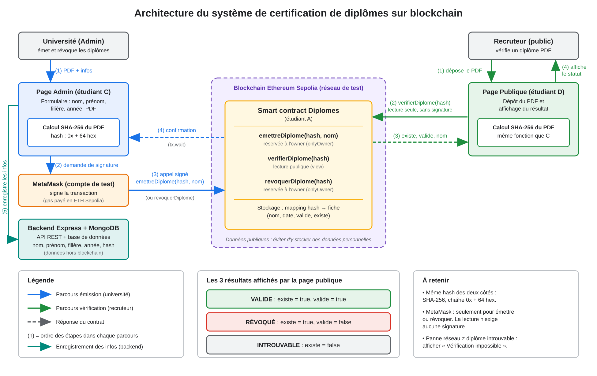

# Architecture du système



## Composants

| Composant | Rôle | Responsable |
|---|---|---|
| Smart contract `Diplomes.sol` | Stocke les hash des diplômes et leur statut (valide ou révoqué) | A |
| Interface Admin | Permet à l'université d'émettre et de révoquer un diplôme | C |
| Interface Publique | Permet à un recruteur de vérifier un PDF | D |
| MetaMask | Signe les transactions de l'université | |
| Backend Express + MongoDB | API REST et base MongoDB : enregistre les informations de l'étudiant et le hash associé, en dehors de la blockchain | C |
| Réseau Sepolia | Blockchain de test où le contrat est déployé | |
| Tests Hardhat | Vérifient le smart contract sur une blockchain locale (`npx hardhat test`) | B |
| Documentation | Schéma d'architecture, README et scénario de démonstration | B |

## Parcours d'émission

1. L'université dépose le PDF dans l'interface Admin.
2. L'interface calcule le hash SHA-256 du PDF.
3. MetaMask signe la transaction `emettreDiplome(hash, nom)`.
4. Le contrat enregistre le hash et confirme.
5. L'interface Admin envoie les informations de l'étudiant au backend, qui les enregistre dans MongoDB.

## Parcours de vérification

1. Le recruteur dépose le PDF dans l'interface Publique.
2. L'interface recalcule le hash SHA-256 avec la même méthode.
3. Elle appelle `verifierDiplome(hash)` (lecture seule, sans signature).
4. Elle affiche le résultat : Valide, Révoqué ou Introuvable.

## Résultats possibles

| Résultat | Condition |
|---|---|
| Valide | `existe = true` et `valide = true` |
| Révoqué | `existe = true` et `valide = false` |
| Introuvable | `existe = false` |

## Tests du contrat (partie B)

Les tests s'exécutent sur une blockchain locale Hardhat, sans Sepolia ni MetaMask :

```
npx hardhat test
```

| N° | Test | Résultat attendu |
|---|---|---|
| 1 | L'owner émet | Diplôme créé et valide |
| 2 | Un intrus émet | Refusé |
| 3 | Même hash deux fois | Refusé (doublon) |
| 4 | Émettre puis vérifier | Existe et valide |
| 5 | Hash jamais émis | Introuvable |
| 6 | Émettre puis révoquer | Existe mais non valide |
| 7 | Un intrus révoque | Refusé |
| 8 | Révoquer deux fois | Refusé |
| 9 | Qui est l'owner ? | Le déployeur |

Résultat : 9 tests, tous réussis. Fichier de tests : `test/Diplomes.A.js`.

## Choix techniques

- Seul le hash est stocké sur la blockchain, pas le PDF : il est petit et préserve la confidentialité du document.
- Seul l'owner du contrat peut émettre et révoquer (`onlyOwner`).
- La vérification est gratuite : c'est une fonction de lecture (`view`).
- Un PDF modifié donne un hash différent, donc il est introuvable.
- Les deux interfaces doivent calculer le hash de la même façon, sinon un diplôme valide serait affiché introuvable.
- Les données personnelles restent hors blockchain, car celle-ci est publique.
- Hardhat compile, teste et déploie le contrat.
