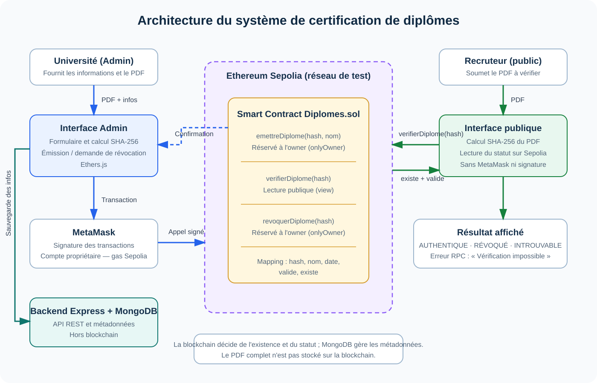

# Architecture du système

Cette documentation décrit les composants et les parcours de l'application DiplomaChain à partir du code du dépôt.



## Composants

| Composant | Rôle | Responsable fonctionnel |
|---|---|---|
| Smart Contract `Diplomes.sol` | Enregistre les empreintes SHA-256, la date et le statut des diplômes ; permet l'émission, la lecture et la révocation | A |
| Interface Admin | Collecte les informations et le PDF, calcule son hash et initie l'émission | C |
| Interface publique | Reçoit le PDF, recalcule le hash et affiche le statut retourné par le contrat | D |
| MetaMask | Permet à l'administrateur autorisé de signer les transactions d'émission ou de révocation | Administrateur |
| Backend Express + MongoDB | Enregistre les métadonnées administratives hors blockchain | C |
| Ethereum Sepolia | Réseau de test hébergeant le contrat | — |
| Hardhat | Compile, déploie et teste le contrat sur un environnement local | B |

## Parcours d'émission

1. L'administrateur saisit les informations du diplômé et sélectionne le PDF dans l'interface Admin.
2. Le navigateur calcule le hash SHA-256 du fichier.
3. MetaMask demande à l'administrateur de signer la transaction.
4. L'interface appelle `emettreDiplome(hash, nom)` sur le contrat déployé sur Sepolia.
5. Après confirmation de la transaction, l'interface transmet les métadonnées à l'API Express, qui les enregistre dans MongoDB.

## Parcours de vérification publique

1. Le recruteur sélectionne le PDF dans l'interface publique.
2. Le navigateur recalcule le hash SHA-256 avec la même méthode que l'interface Admin.
3. L'interface appelle `verifierDiplome(hash)` en lecture seule, à l'aide d'un provider RPC.
4. Le résultat est affiché selon les valeurs renvoyées par le contrat :

| Résultat | Condition |
|---|---|
| **AUTHENTIQUE** | `existe = true` et `valide = true` |
| **RÉVOQUÉ** | `existe = true` et `valide = false` |
| **INTROUVABLE** | `existe = false` |

Une erreur réseau ou une indisponibilité du RPC ne signifie pas qu'un diplôme est introuvable : l'interface doit afficher « Vérification impossible » dans ce cas.

## Révocation d'un diplôme

Le contrat fournit `revoquerDiplome(bytes32 _hash)`, protégée par `onlyOwner`. Le propriétaire du contrat peut appeler cette fonction pour passer le champ `valide` de `true` à `false). L'enregistrement n'est pas supprimé et l'événement `DiplomeRevoque` est émis.

La fonction Solidity existe dans le contrat. L'interface Admin de la branche documentée doit être vérifiée séparément avant d'affirmer qu'un bouton de révocation est disponible : la présence de la fonction dans le contrat ne prouve pas à elle seule que l'interface l'expose.

## Blockchain et MongoDB

- La blockchain constitue la source de vérité pour l'existence et le statut du hash.
- MongoDB conserve les informations administratives utilisées par le tableau de bord.
- La vérification publique ne doit pas dépendre de MongoDB.
- Le PDF complet n'est pas enregistré sur la blockchain : seule son empreinte est utilisée.

## Tests du Smart Contract

Les tests s'exécutent localement avec Hardhat, sans transaction Sepolia ni MetaMask :

```bash
npx hardhat test
```

Le fichier de test présent dans la branche est `test/Diplomes.A.js` et contient neuf scénarios : émission par l'owner, refus d'un compte non autorisé, refus d'un doublon, vérification d'un hash existant et inconnu, révocation, refus de révocation par un intrus, refus d'une double révocation et vérification de l'owner. Relancer la commande pour confirmer le résultat sur le commit courant.

## Règles de cohérence

- Les interfaces Admin et publique doivent calculer le SHA-256 sur les mêmes octets du PDF.
- L'adresse du contrat et l'ABI doivent correspondre au même déploiement Sepolia.
- L'émission et la révocation nécessitent une transaction signée par le propriétaire.
- La lecture publique est une opération `view` et ne nécessite pas de signature.
- Une panne RPC doit être distinguée d'un hash absent du registre.
